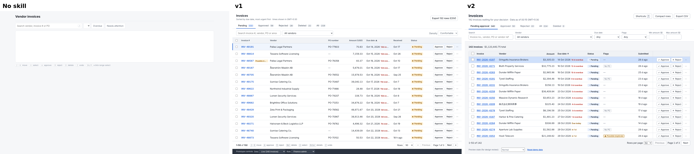
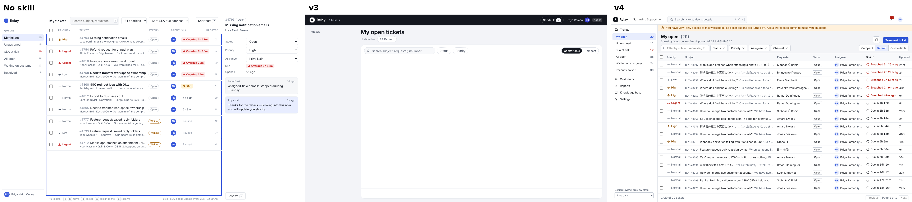

# Enterprise UX — a Claude skill

**A senior enterprise-SaaS designer inside Claude. Plan, grill, design and audit — backed by 12 design systems, NN/g, UX laws and WCAG 2.2.**

Ask any AI to build an admin panel and you get six perfect rows, a centred spinner, a "Delete" button next to "Save", and no idea what happens when the user isn't an admin. Real enterprise software is 50,000-row tables, viewers who can't edit, APIs that time out, screen-reader users, SSO-managed accounts, and bulk actions that can wreck a quarter's data.

This skill gives Claude the judgment to handle all of that — and to tell you when your requirements are the problem.

> Works in **Claude Code** and **Claude.ai** (chat). Free, MIT licensed.

---

## Asks before it designs

A senior designer doesn't guess who the users are, how much data there is, or what the product should look like. Neither does this skill. Every design starts with **Intake**:

1. **Looks first** — finds your design system (tokens, components, theme files) and reads what your request already says.
2. **Asks ≤5 multiple-choice questions**, each with a recommended default: who uses it and how often, the main job, data volume, roles, and — only if there's no design system — the visual direction.
3. **If you're not around**, it writes one `Assumed:` block at the top and builds anyway, so you correct a line instead of re-briefing.

## Any style, not one look

Taste is modelled as **11 dials** (density, shape, depth, canvas, colour strategy, type voice, scale contrast, composition, ornament, motion, data-viz voice) and **12 presets** built from them: Soft bento, Dark precision (Linear-style), Blueprint (Vercel-style), Restraint (Stripe-style), Classic enterprise (Carbon/Fiori/SLDS), Warm paper (Notion-style), Data-dense utility, Swiss, Expressive (Material 3), Neubrutalism, Glass accents, Tactile.

Ask for one, mix two ("Stripe-like restraint, but bento KPIs"), or match a reference. The skill writes the direction down as *lead preset + borrowed dials*, checks a clash list (glass behind tables, brutal shadows on soft corners, serif in dense chrome…) and never breaks the invariants: AA contrast, status colours only for status, app shell, focus, real data, every state. With an existing design system, it keeps your look and only decides composition.

## Four modes

| Mode | Use it to | You get |
|---|---|---|
| **Plan** | Turn a request or PRD into a real plan | Design brief: jobs, roles, data scale, states, permissions, metrics (HEART/CASTLE), research plan |
| **Grill** | Stress-test a requirement or design before building | Ranked hard questions, red flags called out, assumption log |
| **Design** | Build or redesign screens and flows (code, mockup or spec) | Every state, realistic data, accessible by default, self-audited |
| **Audit** | Review an existing screen, flow or codebase UI | Severity-ranked findings (Nielsen 0–4), each with a concrete fix and the rule behind it |

## What it knows

- **Patterns:** data tables, filters & search, forms & saving, empty/loading/error/degraded states, toasts vs banners vs modals, destructive & bulk actions, dialogs, navigation & page archetypes, dashboards & data viz
- **SaaS domains:** onboarding & activation, multi-tenancy, SSO/SCIM, RBAC & permission UI, settings, billing & cancellation, notifications, audit logs & collaboration, API keys/webhooks/CSV import, AI features & agents, i18n/RTL/time zones, performance
- **Foundations:** all 30 Laws of UX, Nielsen's 10 heuristics, Shneiderman, Norman, Gestalt, NN/g's complex-app guidelines, UX writing rules, density/spacing/motion
- **Accessibility:** every WCAG 2.2 A/AA criterion in web-app terms, ARIA patterns with keyboard maps, enterprise a11y (sortable tables, charts, drag alternatives, timeouts), testing method, legal landscape (EAA, EN 301 549, ADA Title II, Section 508)
- **House defaults** for the 18 decisions where big design systems disagree — so Claude stays consistent instead of guessing

Distilled from 375 sources read in October 2026: IBM Carbon, Atlassian, Salesforce Lightning, SAP Fiori, AWS Cloudscape, GitHub Primer, Red Hat PatternFly, GitLab Pajamas, Shopify Polaris, GOV.UK, Material, Ant Design, NN/g, Baymard, W3C/WAI, Laws of UX, Microsoft HAX, Google PAIR and more. Every rule carries its source; legal and time-sensitive items are flagged "verify". See [`sources.md`](plugins/enterprise-ux/skills/enterprise-ux/references/sources.md).

## What it changes

| Without the skill | With the skill |
|---|---|
| Table becomes cards "for a modern look" | Dense table, identifier first, right-aligned numbers, column picker, URL-synced filters |
| Only the ideal state exists | First-use empty, no results, loading, refresh, partial error, no-permission, read-only — all reachable |
| "Are you sure?" → OK | Undo for reversible actions; "Delete 312 invoices?" naming consequences; typed confirm for critical ones |
| Disabled button, no reason | Hidden if never allowed, or disabled with "Only admins can… Ask Priya (Admin)" |
| "Something went wrong" | What happened, how to fix it, input kept, reference ID |
| Accessibility "later" | WCAG 2.2 AA built in: keyboard paths, 24px targets, focus not obscured, drag alternatives |
| Agrees with every requirement | Grills you: data volume, roles, irreversibility, compliance — before you build |

<!-- TODO: add before/after screenshots — the most important part of this README -->

## Structure

```
skills/enterprise-ux/
├── SKILL.md                       # mode router, Intake, non-negotiables, ship gate
└── references/                    # loaded only when needed
    ├── modes/          plan · grill · design · audit
    ├── foundations/    defaults · ux-laws-and-heuristics · accessibility · writing ·
    │                   visual-direction (dials, presets, mixing) · visual-craft · visual-and-motion
    ├── patterns/       tables · filters-and-search · forms-and-saving · feedback-and-states ·
    │                   actions-and-dialogs · navigation-and-layout · dashboards-and-dataviz
    ├── saas/           onboarding · accounts-and-permissions · billing · notifications-system ·
    │                   collaboration-and-audit · integrations-and-data · ai-features · global-and-performance
    └── sources.md
```

Claude reads `SKILL.md` first, then only the files the task needs — so it stays fast.

## Install

### Claude Code

```bash
/plugin marketplace add YOUR-GITHUB-USERNAME/enterprise-ux
/plugin install enterprise-ux@enterprise-ux
```

Or copy the skill folder manually:

```bash
git clone https://github.com/YOUR-GITHUB-USERNAME/enterprise-ux
cp -r enterprise-ux/plugins/enterprise-ux/skills/enterprise-ux ~/.claude/skills/
```

### Claude.ai (chat)

1. Download `enterprise-ux.zip` from the [latest release](../../releases/latest).
2. Upload it under **Skills** in Claude's settings (skills/code execution must be enabled on your plan).

## Try it

```
Plan: we need an approvals inbox for finance managers who review ~200 expense claims a day.
```
```
Grill this PRD before we build it. [paste PRD]
```
```
Build the invoices list page for a finance admin. Include every state.
```
```
Audit this screen for UX and WCAG 2.2 AA. Top 3 issues first. [attach screenshot]
```

## Evals

8 cases (plan, grill, design, audit, accessibility, AI) × 3 conditions × 2 runs = 48 Claude Code sessions, blind-graded against 111 fixed checks per run.

| | No skill | v1 | v2 |
|---|---|---|---|
| **Overall** | 68% | 80% | **91%** |
| Grill a weak PRD | 70% | 55% | **100%** |
| Plan an approvals inbox | 58% | 62% | **96%** |
| Build an invoices list | 28% | 75% | **80%** |
| Make a kanban accessible | 85% | 80% | 85% |



### v4: Intake and visual direction

| Case | No skill | v3 | v4.1 |
|---|---|---|---|
| Vague request: asks ≤5 questions with defaults before building | 28% | 22% | **100%** |
| User away: states assumptions and builds | 46% | 92% | **96%** |
| Existing design system respected (v4) | 50% | 75% | **80%** |
| Mixed style: Stripe restraint + bento KPIs | 55% | 50% | 55–75% |

The first v4 build failed the "asks first" case outright (0%) because the host's own prompt told Claude to start immediately; v4.1 fixed it. Mixed-style results are noisy, and the skill still doesn't reliably state its direction line in the reply. Details: [`2026-10-28-v4/RESULTS.md`](evals/results/2026-10-28-v4/RESULTS.md).



## Disclaimer

Legal notes (accessibility law, auto-renewal/click-to-cancel, EU AI Act) are summaries as of October 2026, not legal advice. Design-system guidance changes; check live docs for anything critical.

## Contributing

Rules are opinionated on purpose. If one is wrong, open an issue with the context where it fails and a source — "it depends" without a case won't be merged.

## Author

**Ankit Pareek** — Lead UX Designer working on enterprise SaaS.
[agooddesigner.in](https://agooddesigner.in) · [@a.good.designer](https://instagram.com/a.good.designer)

MIT License.
